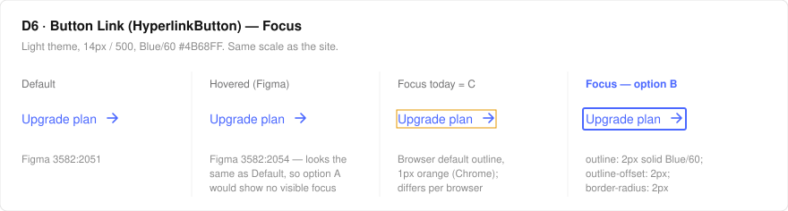
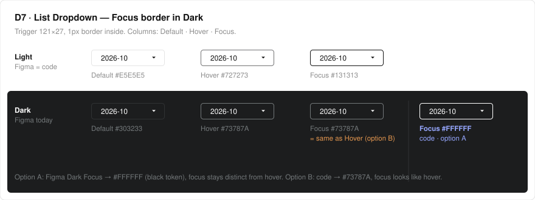

# Open decisions for NS and YJ (Phase 2, Oct 26)

Each section has a recommendation and an answer box. Answer in the
[decision questionnaire](https://claude.ai/artifact/GD31sb6D9zH9rBXxryHSHa) (one card per question, saves on the page);
HJ records the result in `sync-plan.md` and the Confluence plan. None of these block the ≥ 80%
coverage goal (met); they decide what "done" looks like for the handover on Dec 18.

| # | Decision | Owner | Why it matters |
|---|---|---|---|
| D2 | Code-only components: add to Figma or mark code-only | NS | Last gaps between the library and the Figma file |
| D3 | Story-only variants: promote to library components | NS + Dev | Figma variants apps can't use today |
| D4 | One format for variant-level mapping | YJ | `/design-system` turns Figma variants into JSX from it |
| — | Dark mode for 3 illustrations | NS | Left out of #485 (needs design, not code) |
| D6 | Button Link (HyperlinkButton) Focus state | NS, YJ | No focus design in Figma or code; the site shows the browser outline |
| D7 | List Dropdown Focus border in Dark | NS, YJ | Figma and code disagree; the Figma value equals the Dark hover |

---

## D2 — code-only components (NS)

In `@cochlearai/ui` with no Figma component set. **Add to Figma** = design a component set with the
usual axes (`theme`, `type`, `state`); **code-only** = keep out of the coverage count with the reason below.

| Component | What it is | Recommendation | Answer (NS) |
|---|---|---|---|
| `Accordian` | Disclosure list (name typo vs `AccordionIcon`) | Add to Figma | |
| `CodeView` | API key / snippet block | Add to Figma | |
| `UsageBar` + `UsageBarContent` | Plan usage meter; Figma has `Progress_Usage` frames only | Add to Figma as Progress `type=Usage` | |
| `Banner` | Full-width gradient banner (Feedback/Alert stories) | Add to Figma | |
| `UserProfile` | Avatar letter; Figma has loose layers on Menu v1 | Add to Figma | |
| `Notification` | GNB bell with `confirmed` flag | Code-only: covered by Icons/NotificationBell | |
| `CardSortingItem` | Sortable card row | Ask NS (used in one app screen) | |
| `Typo` | Typography primitive | Code-only: foundations, not a component | |
| `Scroll` | Internal scroll utility | Code-only (already decided, D5) | ✅ |

App-only pieces (`TypeSelectButton`, delete-project / webhook / edge-device / price-plan modals,
`ProjectCreateModal`) live in `packages/client`, not the library. **Recommendation:** leave them out of
D2; revisit only if a second app needs them.

## D3 — story-only variants (NS + Dev)

Figma variants that exist only as styled overrides inside Storybook stories, so apps can't import them.

| Variant | Where it lives today | Recommendation | Answer |
|---|---|---|---|
| Date picker | ~~story mock~~ real component is `@cochlearai/calendar` (checked by sync since Oct 16) | ✅ Resolved, no action | ✅ |
| Dropdown `sm` | `Dropdown.stories.tsx` | `size="sm"` prop on `DropdownButton` | |
| Dropdown `timePicker` | `Dropdown.stories.tsx` | `TimePicker` component (or `variant="time"`) | |
| Button `sm` / `md` / `lg` | `Button.stories.tsx` overrides | `size` prop on `Button` (Figma already has the 3 sizes) | |
| Popover `PopoverList` / `PopoverItem` | story-local containers | `PopoverList` + `selected` on `DropdownItem` | |
| Modal "with subtitles and cta" | story-local; app's `ProjectCreateModal` | Library `Modal` slot, or keep app-only | |

Suggested order (smallest first): Button `size` → Dropdown `sm` → Popover `selected` → TimePicker.
Each is one PR to `beta` with snapshots, and one `mapping.json` row moves from "story only" to a target.

## D4 — variant-level mapping format (YJ)

**Today** the mapping says which code component and props a Figma variant becomes in three
different ways, and the engine reads none of them:

| Style | Example | Entries |
|---|---|---|
| `targets[].variant` (free text) | `"variant": "type=Basic\|Red\|md\|sm\|lg"` | Button, Dropdown, Input, Alert, Modal, DatePicker, Menu, Navigation, NumberInput |
| `targets[].props` (free prose) | `"props": "state=Default → <TabItem>; state=Active → selected"` | Alert, Popover, Card, Skeleton, Modal, DatePicker, Tabs, Menu, Navigation |
| `mapping.propMap` (structured rows) | `{ "figma": "type=Red", "code": "<Button color=\"danger\">", "confidence": "verified", "evidence": "…" }` | Button only |

**Recommendation: one structured `propMap` for every entry**, readable by people, `/design-system` and the engine:

```json
"propMap": [
  { "figma": { "type": "Red" },
    "code": { "component": "Button", "props": { "color": "danger" } },
    "confidence": "verified",
    "evidence": "fill #E02E2E (3251:7373) = button.backgroundColor.danger.light" },
  { "figma": { "type": "Link" },
    "code": { "component": "HyperlinkButton", "props": { "text": "{Text}", "rightArrow": "{rightIcon}" } },
    "confidence": "verified" },
  { "figma": { "state": "Hovered" }, "code": { "css": ":hover" }, "confidence": "verified" }
]
```

- `figma`: variant axis → value (the names in the Figma component set).
- `code.component` + `code.props`: what to render; `{Text}` = a Figma text property; `code.css` for states with no prop.
- `confidence`: `verified` | `probable` | `pending` (not published yet).
- Keep `targets[]` for the component list and `ONE_TO_MANY`; drop the free-text `variant` / `props` once rows exist.

**Engine work (small, optional):** `mapping validate` warns when a `propMap` axis/value isn't in the
component's Figma snapshot (`variant.axes`) or `code.component` isn't exported. That catches the
renames we fixed by hand in October (e.g. `smIcon` → `SmallwithIcon`).

**Migration:** HJ converts the existing free text into rows (about 20 entries, one PR); YJ reviews the
format and, if wanted, adds the validator check.

| Question | Answer (YJ) |
|---|---|
| Adopt `propMap` rows as the one format? | |
| Add the validator check (yes / later / no)? | |

## Dark mode for 3 illustrations (NS)

`NotFound` (404 page), `SpeakerProfilesHero`, `RectangleLayer` are drawn in fixed light greys for a
white page. #485 left them as they are; on a dark page they show as light shapes.
Preview: [Storybook, Dark](https://6620cbfd45d0553584c1b84f-ypowhqxghg.chromatic.com/?path=/story/theme-icons--all-icons&globals=theme:dark) (Code only → bottom of the board).

| Option | Effort | Answer (NS) |
|---|---|---|
| A. Keep as is (light on dark is acceptable) | none | |
| B. Dark variants in Figma; code switches by theme | design + small code change | |
| C. Map the greys to theme tokens (like the icons in #485) | code only; may look flat | |

## D6 — Button Link Focus state (NS, YJ)

Found in the usage/api design QA (Oct 27, [report](https://claude.ai/artifact/RG89b5iJQHqrkuzZeJGCgq) #8).
The site link "Go view upcoming invoices" is an `<a>`, so keyboard users land on it and see the
browser's default outline (orange, 1px). Figma `Button` › `type=Link` has Default / Hovered / Disabled
but no Focus, and the Storybook `HyperlinkButton` is a `<span>` that can't take focus at all.
Nothing to copy from either side, so the Focus look needs a design call.



| Option | What it looks like | Effort | Answer (NS) |
|---|---|---|---|
| A. Same as Hovered | Hover style on `:focus-visible` — but Figma Hovered looks the same as Default, so focus would not be visible unless Hovered changes too | Figma variant + 1 CSS rule | |
| B. Focus ring (recommended) | 2px Blue/60 outline, 2px offset, 2px radius; text unchanged | Figma variant + 1 CSS rule | |
| C. Keep the browser default | Orange 1px outline (differs per browser) | none | |

Either A or B also needs `HyperlinkButton` to render a focusable element (`<button>` or `<a>`) — YJ to
confirm it's fine to change in `@cochlearai/ui`.

| Question | Answer (YJ) |
|---|---|
| OK to make `HyperlinkButton` focusable (`<button>` / `<a>`)? | |

## D7 — List Dropdown Focus border in Dark (NS, YJ)

| Where | Light Focus | Dark Focus | Dark Hover |
|---|---|---|---|
| Figma `Dropdown` › `type=List Dropdown` | #131313 | **#73787A** | #73787A (added Oct 27) |
| Code `DropdownButton` (`cochl-dashboard#493`) | #131313 (`colors.black`) | **#FFFFFF** (`colors.black` in Dark) | #73787A (`grey[80]`) |

Light already matches. In Dark, the Figma Focus border is the same grey as Hover, so keyboard focus
would look like a hover.



| Option | Change | Answer (NS) |
|---|---|---|
| A. Figma follows code (recommended) | Dark Focus border → #FFFFFF (`black` token); focus stays distinct from hover | |
| B. Code follows Figma | Dark `:focus-visible` → `grey[80]`; focus and hover look the same | |
